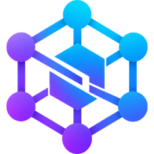
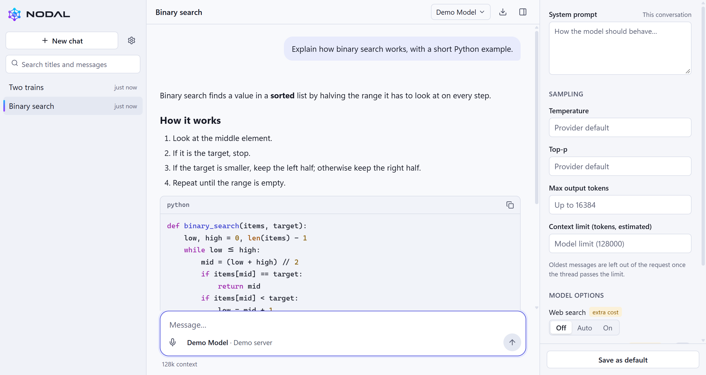
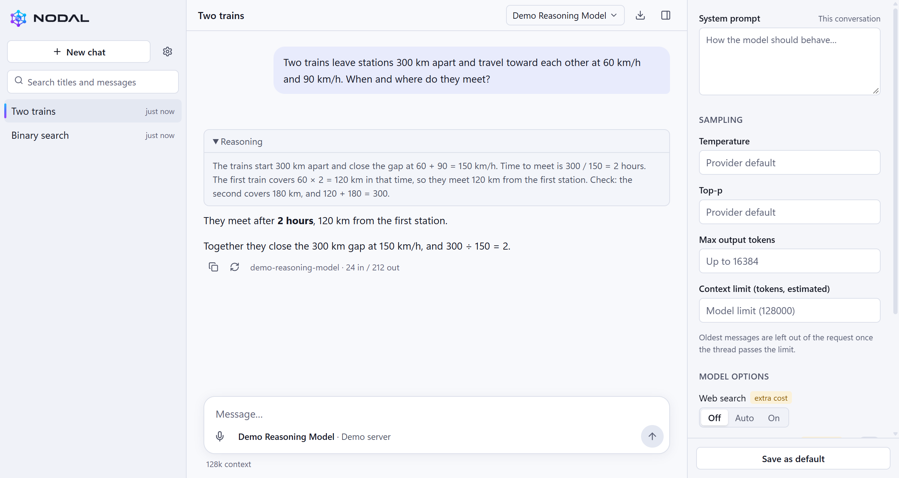
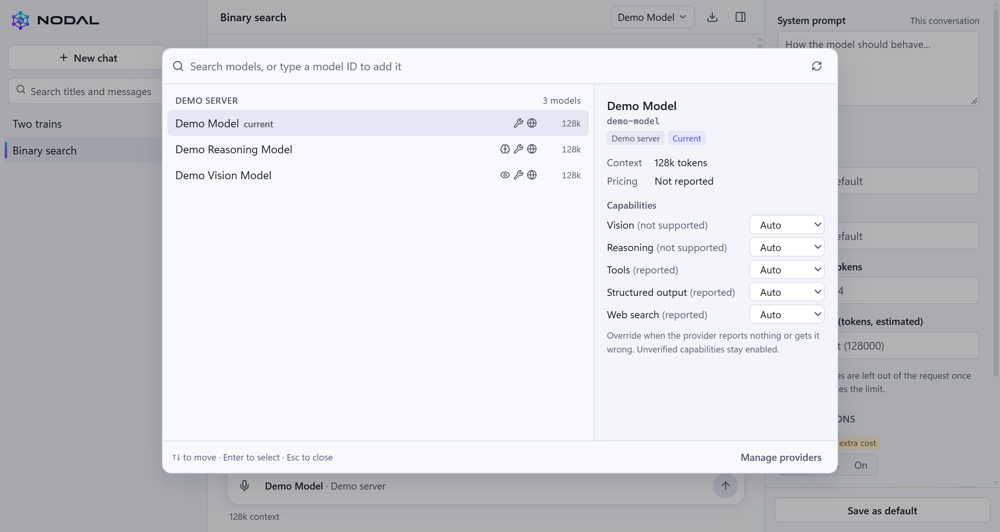
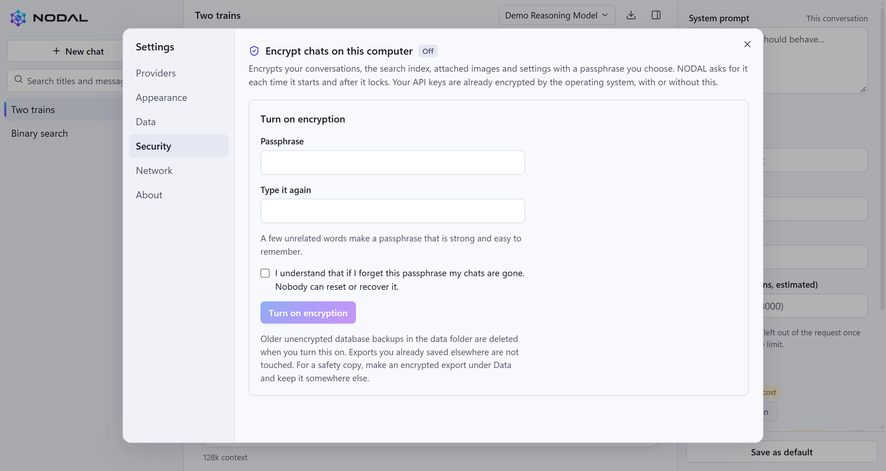
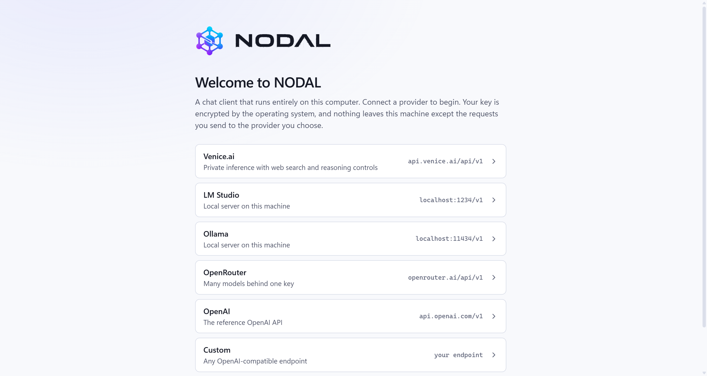
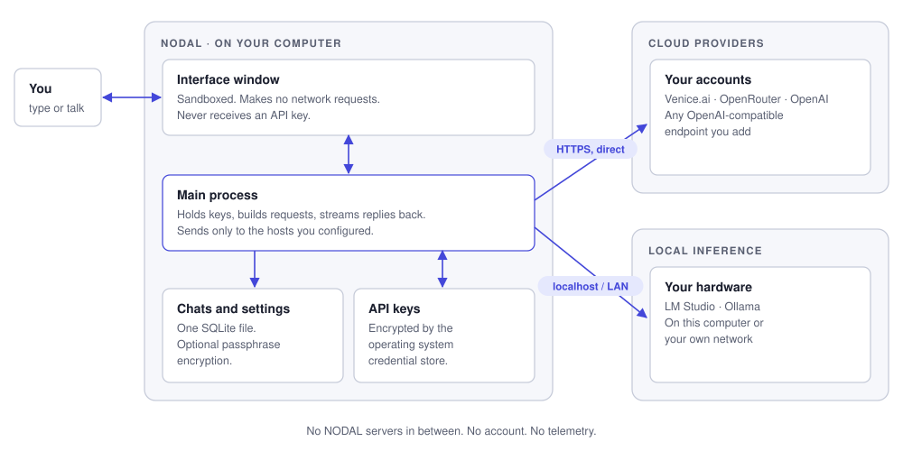

<div align="center">



# NODAL

**Your models. Your endpoints. Your control.**

A desktop interface for AI models that connects straight to the providers and local servers you choose.<br>
No account, no middleman, no telemetry.

<a href="https://github.com/Nocturnxl/nodal/releases/latest"></a>

[](https://github.com/Nocturnxl/nodal/releases/latest)
[](https://github.com/Nocturnxl/nodal/actions/workflows/ci.yml)
[](LICENSE)


[Download](#download-and-installation) · [Quick start](#quick-start) · [Capabilities](#provider-capability-matrix) · [Privacy](#privacy-and-data-handling) · [Documentation](#documentation)

</div>

<br>

<picture>
  <source media="(prefers-color-scheme: dark)" srcset="assets/screenshots/chat-dark.png">
  
</picture>

<table>
  <tr>
    <td width="50%">
      <picture>
        <source media="(prefers-color-scheme: dark)" srcset="assets/screenshots/reasoning-dark.png">
        
      </picture>
      <p align="center"><sub>Reasoning in its own block, apart from the answer</sub></p>
    </td>
    <td width="50%">
      <picture>
        <source media="(prefers-color-scheme: dark)" srcset="assets/screenshots/models-dark.png">
        
      </picture>
      <p align="center"><sub>One model picker across every provider you connect</sub></p>
    </td>
  </tr>
  <tr>
    <td width="50%">
      <picture>
        <source media="(prefers-color-scheme: dark)" srcset="assets/screenshots/voice-dark.png">
        
      </picture>
      <p align="center"><sub>Voice chat: speak, and hear the reply</sub></p>
    </td>
    <td width="50%">
      <picture>
        <source media="(prefers-color-scheme: dark)" srcset="assets/screenshots/security-dark.png">
        
      </picture>
      <p align="center"><sub>Optional passphrase encryption of everything on disk</sub></p>
    </td>
  </tr>
</table>

<sub>Screenshots show the application as it ships, connected to a local demo server. The model names and replies in them are placeholders.</sub>

## Overview

NODAL is a desktop application for talking to AI language models. You tell it where a model lives — a cloud provider such as Venice.ai, OpenRouter or OpenAI, a model running on your own computer through LM Studio or Ollama, or any other server that speaks the OpenAI-compatible API — and it gives you one consistent, capable interface for all of them.

Most chat applications are tied to one company's models and keep your conversations on that company's servers. NODAL is the opposite arrangement:

- **You choose the models.** Connect as many providers as you like and switch between them in one picker.
- **You choose the endpoints.** Any OpenAI-compatible base URL works, including ones on your own machine or network.
- **You keep the data.** Conversations live in a file on your computer. Requests go directly from your computer to the provider you picked, and nowhere else.
- **You hold the controls.** System prompts, sampling parameters, context limits and each provider's own options are in plain view, per conversation.

It is built for people who want more control over how they work with AI models: enthusiasts, researchers, technical professionals and developers. Using it requires no programming.

> [!NOTE]
> NODAL is an early release (0.1.0). Windows is the platform it is developed and used on. The macOS and Linux builds pass the same automated tests but have not yet been verified by hand; see [project status](#project-status).

## Core capabilities

| | |
| --- | --- |
| **Multi-provider connectivity** | Presets for Venice.ai, OpenRouter, OpenAI, LM Studio and Ollama, plus custom endpoints. Add several and move between their models freely, even mid-conversation. |
| **Local and cloud models** | Cloud providers over HTTPS; local servers on your own computer or network. NODAL treats them the same. |
| **Conversations you can steer** | Streamed replies with Stop, regenerate, continue, and edit-and-resend. Every edit creates a branch you can switch back to, so no version of a conversation is lost. |
| **Inference controls** | Temperature, top-p, maximum output tokens and a context limit, per conversation, with the model's own defaults shown where the provider reports them. |
| **System prompts** | A system prompt per conversation and a default for new ones. |
| **Reasoning made visible** | Models that expose their thinking show it in a separate, collapsible block, whether it arrives as a dedicated field or as inline `<think>` tags. |
| **Images** | Attach, paste or drop PNG, JPEG, WebP and GIF images for models with vision. |
| **Voice chat** <sub>experimental</sub> | Speak, and hear the reply read aloud. Turn-based, available with Venice.ai. |
| **Provider-specific options** | Each provider's extras appear as ordinary controls: with Venice.ai, web search, citations, thinking controls and characters. |
| **Search, export, import** | Full-text search across every conversation. Export one conversation as Markdown or JSON, or everything as a ZIP, optionally passphrase-protected; import it back anywhere. |
| **Encryption and locking** | Optional passphrase encryption of all conversations, images and settings on disk, with Lock now, auto-lock, and an opt-in wipe after five wrong passphrases. |
| **Usage at a glance** | Token counts per reply, and balance and rate-limit readouts when the provider reports them. |

### Provider capability matrix

What works where. "Model-dependent" means NODAL supports it and the model you pick must too.

| Capability | Venice.ai | OpenRouter | OpenAI | LM Studio | Ollama | Custom endpoint |
| --- | :---: | :---: | :---: | :---: | :---: | :---: |
| One-step preset | Yes | Yes | Yes | Yes | Yes | Manual URL |
| Streaming chat, stop, regenerate, branches | Yes | Yes | Yes | Yes | Yes | Yes |
| Automatic model list | Yes | Yes | Yes | Yes | Yes | If served¹ |
| API key check on entry | Yes | Yes | Yes | No key needed | No key needed | If required² |
| System prompt and sampling controls | Yes | Yes | Yes | Yes | Yes | Yes |
| Reasoning shown separately | Model-dependent | Model-dependent | Model-dependent | Model-dependent | Model-dependent | Model-dependent |
| Image input | Model-dependent | Model-dependent | Model-dependent | Model-dependent | Model-dependent | Model-dependent |
| Model details (context size, price, capabilities) | Full | Context and price | — | — | — | If reported |
| Rate-limit readout | Yes | If reported | If reported | — | — | If reported |
| Account balance readout | Yes | — | — | — | — | — |
| Web search, citations, URL scraping | Yes | — | — | — | — | — |
| Thinking controls (strip, disable) | Yes | — | — | — | — | — |
| Characters | Preview | — | — | — | — | — |
| Voice chat | Experimental | — | — | — | — | — |
| **Verified against the live service** | Chat: yes³ | Key check and model list | Not yet | Not yet | Not yet | — |

<sub>¹ If the endpoint has no model list, add model IDs by hand. ² Checked with an authenticated model-list request; an endpoint that serves its list without a key cannot prove one. ³ Venice chat, streaming, reasoning and key validation were run against the live API. Characters and voice were built from Venice's API reference and tested against a local stand-in only.</sub>

Only OpenAI-compatible APIs are supported today. Providers with their own API formats, such as Anthropic and Google, are not available except through a compatible gateway like OpenRouter.

## Download and installation

Installers are published on the [**Releases page**](https://github.com/Nocturnxl/nodal/releases/latest). You do not need to clone this repository or build anything.

| Platform | Download | Status |
| --- | --- | --- |
| **Windows** 10 or later, 64-bit | [NODAL-Setup-windows-x64.exe](https://github.com/Nocturnxl/nodal/releases/latest/download/NODAL-Setup-windows-x64.exe) | Developed and used on Windows 11 |
| **macOS**, Apple Silicon (M1 or later) | [NODAL-macos-arm64.dmg](https://github.com/Nocturnxl/nodal/releases/latest/download/NODAL-macos-arm64.dmg) | Experimental: automated tests only |
| **Linux**, x86-64, AppImage | [NODAL-linux-x86_64.AppImage](https://github.com/Nocturnxl/nodal/releases/latest/download/NODAL-linux-x86_64.AppImage) | Experimental: automated tests only |
| **Linux**, x86-64, Debian/Ubuntu | [NODAL-linux-amd64.deb](https://github.com/Nocturnxl/nodal/releases/latest/download/NODAL-linux-amd64.deb) | Experimental: automated tests only |

On the Releases page, the files named `NODAL-…` are the installers. "Source code (zip)" and "Source code (tar.gz)" are the program's source, which most people do not need.

**Before you install, two things to know:**

- **The installers are not code-signed yet.** Windows shows a SmartScreen warning ("Windows protected your PC": choose *More info*, then *Run anyway*), and macOS refuses to open the app until you allow it in *System Settings → Privacy & Security*. The [installation guide](docs/installation.md) walks through both.
- **Verify your download if you wish.** Each release includes `SHA256SUMS.txt`. The installation guide shows how to compare it with the file you downloaded.

There is no automatic update yet: to update, download and install the newer release. Your conversations and settings are kept.

Full, step-by-step instructions for each platform, system notes, and how to uninstall are in the [installation guide](docs/installation.md). Intel Macs and ARM builds for Windows or Linux are not provided.

## Quick start

1. **Install and open NODAL.** The welcome screen lists the providers it knows.
2. **Pick a provider.**
   - *Have an account with Venice.ai, OpenRouter or OpenAI?* Choose it and paste your API key. NODAL checks the key and loads the provider's models.
   - *Running LM Studio or Ollama?* Start its local server, choose its preset, and connect. No key is needed.
   - *Something else?* Choose **Custom** and enter the base URL of any OpenAI-compatible endpoint.
3. **Choose a model** from the list that appears.
4. **Type a message and press Enter.** The reply streams in as it is generated.

<picture>
  <source media="(prefers-color-scheme: dark)" srcset="assets/screenshots/welcome-dark.png">
  
</picture>

From there: `Ctrl+K` switches model, `Ctrl+N` starts a new chat, and the panel on the right holds the system prompt and controls for the current conversation. The [quick start guide](docs/quick-start.md) covers the first ten minutes, and the [user guide](docs/user-guide.md) covers everything else.

## Technical overview

<picture>
  <source media="(prefers-color-scheme: dark)" srcset="assets/branding/architecture-dark.svg">
  
</picture>

NODAL is a self-contained desktop application built on Electron, with a React interface and a local SQLite database. It has two parts that are deliberately kept apart:

- The **interface window** draws the screen. It is sandboxed, cannot reach the network, and is never given an API key.
- The **main process** owns everything sensitive: it stores keys and conversations, builds requests, talks to providers, and streams replies back to the window.

A provider is described by data (a base URL and how to authenticate) plus a thin adapter. Every provider runs through one shared OpenAI-compatible adapter; a provider's extras, such as Venice's web search or voice services, plug into it without touching the rest of the application. The [architecture document](docs/architecture.md) describes this in detail.

### Privacy and data handling

| Question | Answer |
| --- | --- |
| **Where are my API keys stored?** | On your computer, encrypted by the operating system's credential store (Windows DPAPI, macOS Keychain, or libsecret/KWallet on Linux). The interface window can never read a key back; it can only see whether one is saved and its last four characters. |
| **How are requests sent?** | Directly from your computer to the provider's address, over HTTPS. Plain HTTP is allowed only for servers on your own computer, and on your local network after you confirm it. |
| **What leaves my machine?** | Only what a request needs, sent only to the provider you chose for that conversation: your messages and attached images, the system prompt, the settings for that request, and that provider's API key. With voice chat on, your recorded speech and the text to be spoken go to the same provider. |
| **Is there a NODAL server in between?** | No. NODAL has no servers, no accounts and no relay. Nothing is sent to its authors. |
| **Telemetry, analytics, crash reports?** | None. |
| **Where are my conversations?** | In a single database file in NODAL's data folder on your computer, with attached images beside it. Optionally encrypted with a passphrase only you know. |
| **Does NODAL contact anything on its own?** | No. The update check is off by default, and no update feed is configured in this release. |

What a provider does with the requests it receives is governed by that provider's own terms; NODAL has no say in it. NODAL's security design is described in [SECURITY.md](SECURITY.md) and the [architecture document](docs/architecture.md). It has not yet had an independent security review.

### Configuration

Everything is configured inside the application: providers and keys, per-conversation controls, default prompts, appearance, a network proxy, encryption and locking. The [configuration reference](docs/configuration.md) lists every setting, how to add a custom endpoint, and the few environment variables NODAL reads.

## Documentation

| Guide | What it covers |
| --- | --- |
| [Installation](docs/installation.md) | Step-by-step for Windows, macOS and Linux; security warnings; checksums; updating and uninstalling |
| [Quick start](docs/quick-start.md) | From first launch to a first conversation |
| [User guide](docs/user-guide.md) | Every feature: conversations, branches, model options, images, voice, search, export, encryption |
| [Configuration](docs/configuration.md) | Providers and custom endpoints, all settings, the data folder, environment variables |
| [Troubleshooting](docs/troubleshooting.md) | Connection errors, keys, local servers, the microphone, forgotten passphrases |
| [Architecture](docs/architecture.md) | How NODAL is built, its security model, and how data is stored and encrypted |

## Developer resources

Building from source is an alternative for developers. It is not needed to use NODAL.

```bash
git clone https://github.com/Nocturnxl/nodal.git
cd nodal
npm install
npm run dev
```

Node.js 24 is what the project is built and tested with. `npm run mock` starts a local stand-in provider, so you can develop without an account or key.

- [Development guide](docs/development.md): environment, scripts, tests, packaging and the release process
- [Architecture](docs/architecture.md): code layout, the provider adapter interface, the IPC contract
- [Contributing](CONTRIBUTING.md): how to report problems and propose changes
- [Measurements](docs/measurements.md): recorded performance figures and how they were taken

**Extensibility.** There is no plugin system. New providers are added in code through the adapter extension interface described in the architecture document. NODAL exposes no public API of its own.

## Project information

### Project status

| | |
| --- | --- |
| **Implemented** | Everything under [core capabilities](#core-capabilities) except the items marked below. Covered by automated unit and end-to-end tests on Windows, macOS and Linux on every change. |
| **Experimental** | Voice chat and the Venice character list (built from Venice's API reference, where those endpoints are marked Beta or Preview, and not yet confirmed against the live service). The macOS and Linux builds (never run by hand). The OpenAI, LM Studio and Ollama presets (built from each provider's documentation, not yet run against them). |
| **Planned, not available** | Code-signed installers and automatic updates. Adapters for non-OpenAI-compatible APIs. A choice of voices for voice chat. A prompt library. Model-generated conversation titles. Languages other than English. |

Planned items are intentions, not commitments, and none of them is in the current release.

### Help test on macOS and Linux

No one has yet used the macOS or Linux build by hand. If you have a Mac or a Linux desktop and a few minutes, installing NODAL and filing a [platform test report](https://github.com/Nocturnxl/nodal/issues/new?template=platform_test_report.yml) is the single most useful contribution right now, whether everything works or not.

### More

- **Release history:** [CHANGELOG.md](CHANGELOG.md)
- **Report a problem or request a feature:** [open an issue](https://github.com/Nocturnxl/nodal/issues/new/choose)
- **Report a security vulnerability privately:** [SECURITY.md](SECURITY.md)
- **License:** [MIT](LICENSE)
- **Acknowledgments:** NODAL is built on Electron, React, SQLite (through SQLite3 Multiple Ciphers and better-sqlite3) and many other open-source projects, all listed with their licences in [THIRD-PARTY-NOTICES.md](THIRD-PARTY-NOTICES.md).

NODAL is an independent project. It is not affiliated with or endorsed by Venice.ai, OpenRouter, OpenAI, LM Studio, Ollama or any other provider named here; their names are used only to say what NODAL can connect to.
