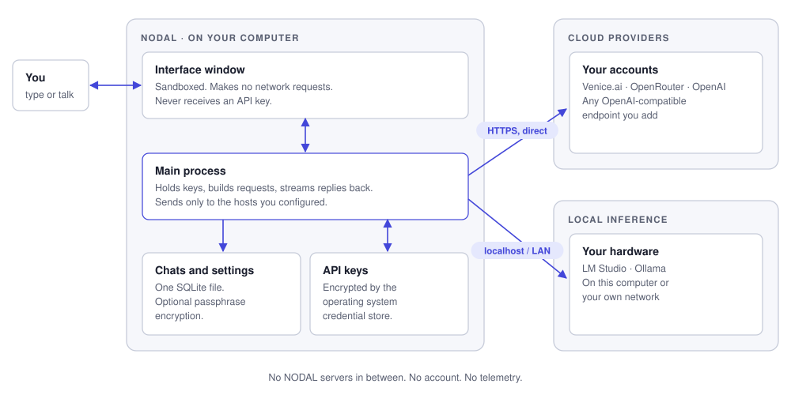

# Architecture

How NODAL is built, how it protects keys and conversations, and where its limits are. Written for a technical reader; no part of it is needed to use the application.

<picture>
  <source media="(prefers-color-scheme: dark)" srcset="../assets/branding/architecture-dark.svg">
  
</picture>

## Overview

NODAL is an Electron application: a Chromium window for the interface and a Node.js main process behind it, with a SQLite database on disk. It has no server component. Every network request it makes on your behalf goes from the main process directly to a provider you configured.

| Layer | Technology |
| --- | --- |
| Shell | Electron |
| Interface | React, Zustand, Radix UI, Tailwind CSS |
| Language | TypeScript, strict mode, throughout |
| Storage | SQLite through `better-sqlite3-multiple-ciphers` (SQLite3 Multiple Ciphers), write-ahead logging, full-text search |
| Validation | zod schemas on every message between window and main process |
| Tests | Vitest (unit), Playwright driving the built app (end to end), axe-core (accessibility) |
| Packaging | electron-builder, with Electron fuses |

## The two processes

The split between window and main process is the core of the design.

**The interface window (renderer)** draws the screen and nothing more. It runs sandboxed with context isolation and no Node.js access. Its content security policy sets `connect-src 'none'`, and a request filter cancels anything outside the app's own `app://nodal` origin, so it cannot make a network request even if it were made to try. It never receives an API key: there is no call that returns one.

**The main process** is the only code that touches keys, the network and the disk. It stores and decrypts keys, builds provider requests, parses streamed replies, writes the database, and passes text back to the window.

They talk over a fixed set of typed channels, exposed to the window as `window.nodal`. Every handler in the main process first checks that the caller is the app's own page in the top frame, then validates the payload against a zod schema, and converts failures into a normalized error. The whole surface is declared in [`src/shared/api.ts`](../src/shared/api.ts).

## Code layout

```text
src/
  main/                 the only place that touches secrets, the network and the disk
    index.ts            app lifecycle, window, sessions, hardening, locking
    ipc/                handlers; each checks the sender and validates its payload
    providers/          adapter interface, the shared OpenAI-compatible adapter, provider extensions, registry
    chat/               stream manager (retry, cancel, persistence) and context trimming
    net/                fetch wrapper, SSE parser, timeouts, error normalization, redaction, URL policy
    db/                 SQLite connection, numbered SQL migrations, all queries
    secrets/            key store, encryption vault, auto-lock, wipe
    data/exporter.ts    Markdown / JSON / ZIP export and merge import
  preload/index.ts      the contextBridge surface `window.nodal`
  renderer/             React interface; makes no network requests
  shared/               types, zod schemas, presets, the IPC contract
tests/
  mock/                 a local stand-in provider
  unit/                 Vitest
  e2e/                  Playwright driving the built app
  fixtures/             a recorded Venice model-list response
```

## Providers and adapters

A provider is data (base URL, authentication scheme, optional headers) plus an adapter. All current providers use one shared adapter, [`providers/openaiCompatible.ts`](../src/main/providers/openaiCompatible.ts), which implements model listing, key validation and streamed chat against the OpenAI chat completions format.

Differences between providers are expressed as a **provider extension** ([`providers/adapter.ts`](../src/main/providers/adapter.ts)), an object the shared adapter consults:

| Hook | Purpose |
| --- | --- |
| `mapModel` | Read the provider's model metadata: context size, pricing, capabilities |
| `extensions` | Declare provider-specific controls as a schema; the interface renders them without knowing the provider |
| `lookup` | Supply choices for a control from the provider, such as Venice's character list |
| `applyToRequest` | Add the provider's fields to a chat request |
| `metaFromHeaders` | Read balance, deprecation notices and the like from response headers |
| `validateKey` | Check a key with an authenticated call, where the model list is public |
| `speech` | Speech-to-text and text-to-speech, where the provider offers them |

Venice ([`providers/venice.ts`](../src/main/providers/venice.ts)) uses all of them; OpenRouter ([`providers/openrouter.ts`](../src/main/providers/openrouter.ts)) supplies key validation. Adding a provider with a different API format would mean a new adapter registered in [`providers/registry.ts`](../src/main/providers/registry.ts). This is a code-level interface, not a plugin system: there is no way to load an adapter at runtime.

Servers differ on a few optional fields. When one rejects `stream_options`, `max_tokens`, `temperature` or `top_p` by name with a 400, NODAL drops or renames that field (`max_tokens` becomes `max_completion_tokens`) and retries before any output, so it cannot duplicate text.

## Conversations as a tree

Messages are stored as a tree, each with a parent. Editing a message or regenerating a reply adds a sibling instead of overwriting, and the conversation remembers which leaf is active. The visible thread is the path from the root to that leaf. This is what makes branches and "previous version / next version" possible without losing anything.

A reply is written to the database as it streams, so closing the app or losing the connection leaves the partial text, marked interrupted.

## Security model

- **The window never sees a key.** No channel returns one. `keys.status` returns only whether a key exists and its last four characters.
- **Keys are encrypted by the operating system** through Electron `safeStorage` (DPAPI on Windows, Keychain on macOS, libsecret or KWallet on Linux) and stored as ciphertext in `keys.json`. On Linux, if only the unprotected `basic_text` backend is available, NODAL refuses to store keys and says why.
- **A key stays with its host.** Changing a provider's host deletes its stored key.
- **The window is locked down:** context isolation, sandbox, no Node integration, a strict CSP, and a request filter restricted to the app's own origin. Navigation, new windows and webviews are denied.
- **Web permissions are denied** except writing to the clipboard (for Copy buttons) and, for voice chat, the microphone: audio only, only for the app's own page.
- **Provider traffic uses its own in-memory session** with no cookies or cache on disk, and an egress allowlist: only hosts of configured providers can be contacted. HTTPS is required; plain HTTP is allowed for loopback, and for LAN addresses after a per-provider confirmation.
- **Model output is untrusted.** Markdown is rendered without raw HTML. Links open in the system browser only after a native dialog shows the full URL, and only `http(s)` links are accepted. Remote images are never fetched.
- **Packaged builds set Electron fuses:** `RunAsNode` off, `EnableNodeOptionsEnvironmentVariable` off, `EnableNodeCliInspectArguments` off, `OnlyLoadAppFromAsar` on, `EnableEmbeddedAsarIntegrityValidation` on. `npm run verify:package` checks these on the built app, including that a tampered archive refuses to start.
- **Deletion is real.** Deleting a conversation deletes its attached images (unless another conversation uses the same file) and overwrites the deleted rows (`secure_delete`).
- **No telemetry, analytics or crash upload.** The update check is off by default, and no update feed is configured.
- **Logs are metadata only:** events, sizes, status codes and error messages. Never message text, keys or passphrases.

### Not yet done

- **Code signing and notarization.** Builds are unsigned.
- **An independent security review.** The design above, including the encryption below, has not been reviewed by anyone outside the project.
- **Build-time advisories.** `npm audit` reports issues in two glob libraries used only by build tools; nothing affected ships in the application, and `npm audit --omit=dev` is clean, which CI enforces.

## What leaves the machine

Only requests to the provider selected for a conversation:

| Request | Sent |
| --- | --- |
| Chat | The messages on the active path (within the context limit), attached images, the system prompt, sampling parameters, provider options, and the provider's API key |
| Model list, key check | The API key |
| Venice characters | The API key and your search text |
| Voice chat (Venice) | Recorded speech for transcription; reply text for speech |

Nothing is sent anywhere else. There is no NODAL service to send it to.

## Storage

Everything is in the user-data folder. The [configuration reference](configuration.md#the-data-folder) lists its contents. The database is SQLite in WAL mode with numbered SQL migrations; a copy is saved to `backups/` before each migration.

## Encryption at rest

Optional, off by default.

- **Coverage.** The whole database (conversations, the search index, settings, provider configuration, the request log), its journal files and migration backups, and attached images. API keys are separate and always encrypted by the operating system.
- **Keys.** A random 256-bit master key encrypts everything. Sub-keys are derived from it with HKDF-SHA256 for the database, for attachment contents and for attachment file names.
- **Database.** SQLCipher's format (AES-256 with a per-page HMAC) through SQLite3 Multiple Ciphers.
- **Attachments.** Each image is AES-256-GCM ciphertext. Its file name is an HMAC of the content hash, so neither the contents nor which images you hold can be read from the folder.
- **Passphrase.** Stretched with scrypt (N = 2^17, about 128 MB per guess) into a key that seals the master key in `vault.json` with AES-256-GCM. Changing the passphrase re-seals the master key; it does not rewrite the data. A wrong passphrase is detected by the seal's authentication tag before the database is touched.
- **Turning it on or off** rewrites the existing database and images in place, with no restart. If the app is closed part-way, the next unlock finishes the job. Turning it on deletes older, unencrypted migration backups.
- **Locking** closes the database, removes the handlers that read it, wipes the keys from memory and reloads the window onto the lock screen. It happens on quit, on Lock now, after the chosen idle time, and when the computer locks or sleeps (Linux does not report a locked screen, so only the timer and sleep apply there).
- **Wrong-passphrase wipe (optional).** The fifth consecutive wrong passphrase destroys the sealed key, then deletes the database, images, backups and stored API keys. The count is kept in `vault.json` so a restart does not reset it.
- **Encrypted exports.** A `.nodalx` file is the ZIP export sealed with scrypt and AES-256-GCM under its own passphrase.
- **No recovery.** Without the passphrase the master key cannot be unsealed, by anyone.

**What it does not protect against:** software running as you while NODAL is unlocked; a keylogger; a weak passphrase. While unlocked, the keys are in the main process's memory. The wrong-passphrase count stops guessing at the keyboard, not someone who copies the data folder or edits `vault.json`. Text that was on disk before encryption was turned on is overwritten in the database file, but a file system or SSD may keep old blocks, so full-disk encryption is still worth having.

## Voice chat

Three ordinary requests with the provider key, all from the main process: speech to text, the usual chat request, and text to speech once per sentence or so. The window records and plays audio; it never holds the key. Recording happens only while listening, so the application does not hear its own voice. Spoken turns are stored as text; audio exists in memory until it has been transcribed or played.

Voice chat is turn-based because Venice offers no realtime speech-to-speech API.

## Known differences and limits

- **Connect timeout.** Chromium owns the socket, so the connect phase cannot be timed separately. Model-list and key-validation calls get 15 seconds to return headers. Chat requests get the first-byte budget (60 seconds by default) to return headers and again for the first body byte, then 90 seconds between chunks.
- **Continue.** No OpenAI-compatible provider advertises assistant-prefix support detectably, so Continue sends the partial reply back followed by an instruction to carry on, and appends the result to the same message.
- **Context limit.** Token counts for trimming are estimates, not the provider's tokenizer.
- **One window, one user.** NODAL is a single-user application with a single window.
- **English only.**
