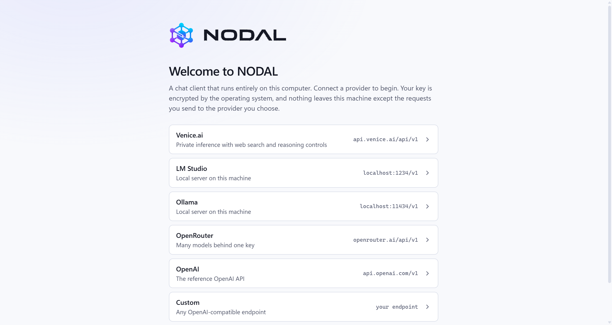
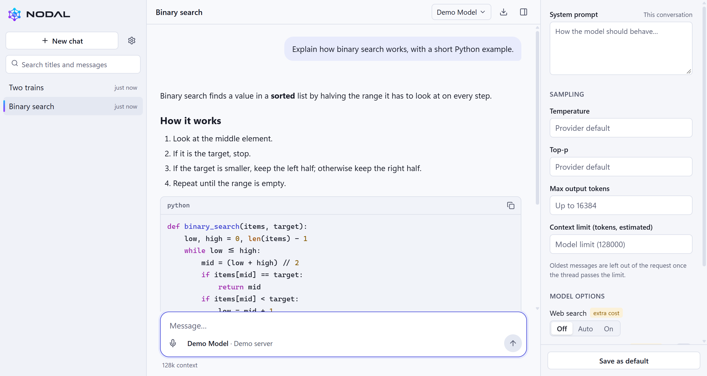

# Quick start

From a fresh install to your first conversation. If NODAL is not installed yet, see [Installing NODAL](installation.md).

## 1. Connect a provider

When NODAL opens for the first time, it shows the providers it has presets for.

<picture>
  <source media="(prefers-color-scheme: dark)" srcset="../assets/screenshots/welcome-dark.png">
  
</picture>

A *provider* is wherever the model runs. Pick the case that fits you.

### I have an account with a cloud provider

Choose **Venice.ai**, **OpenRouter** or **OpenAI**, paste your API key, and choose **Connect**.

An API key is a long secret string the provider gives you, usually on a page called "API keys" in your account settings. It is what lets an application use your account, and it is billed to you, so treat it like a password.

NODAL checks the key with the provider before saving it. A rejected key is not kept. A saved key is encrypted by your operating system and is never shown again; NODAL displays only its last four characters.

### I run models on my own computer

Start the local server in **LM Studio** (the *Developer* or *Local Server* tab) or make sure **Ollama** is running, then choose its preset and **Connect**. No key is needed. NODAL expects LM Studio at `http://localhost:1234/v1` and Ollama at `http://localhost:11434/v1`, their usual addresses; change the URL in the form if yours differs.

### I have some other endpoint

Choose **Custom**, give it a name, and enter the **base URL** of any OpenAI-compatible API, with a key if it needs one. See [custom endpoints](configuration.md#custom-endpoints) for the details.

## 2. Choose a model

After connecting, NODAL lists the models the provider offers. Pick one. Icons beside a model show what the provider says it can do, such as vision or reasoning.

You can change model at any time with `Ctrl+K`, including in the middle of a conversation.

## 3. Send a message

Type in the box at the bottom and press `Enter`. (`Shift+Enter` makes a new line.) The reply appears as it is generated. The round button stops it; `Esc` does the same.

<picture>
  <source media="(prefers-color-scheme: dark)" srcset="../assets/screenshots/chat-dark.png">
  
</picture>

## 4. Find your way around

- **Left:** your conversations, with search across titles and message text. Hover over one to pin, rename, archive or delete it.
- **Centre:** the conversation. Hover over a message for its actions: copy, edit and resend, regenerate.
- **Right:** the inspector, with this conversation's system prompt, sampling controls and the model's own options. `Ctrl+I` shows or hides it.
- **Gear icon:** settings, including providers, appearance, data, security and network.

| Shortcut | Action |
| --- | --- |
| `Ctrl+N` | New chat |
| `Ctrl+K` | Switch model |
| `Ctrl+L` | Focus the message box |
| `Esc` | Stop the reply |
| `Ctrl+I` | Show or hide the inspector |
| `Ctrl+,` | Settings |
| `Ctrl+Shift+L` | Lock (when encryption is on) |

On macOS, use `Cmd` in place of `Ctrl`.

## Good next steps

- **Add another provider:** *Settings → Providers*. All their models appear in the same picker.
- **Give the model standing instructions:** the *System prompt* box in the inspector, or a default for new chats under *Settings → Appearance*.
- **Protect your conversations:** *Settings → Security* turns on passphrase encryption. Read the warning there first: a forgotten passphrase cannot be recovered.
- **Keep a backup:** *Settings → Data → Export ZIP*, or *Encrypted export*.

The [user guide](user-guide.md) covers each feature in full.
