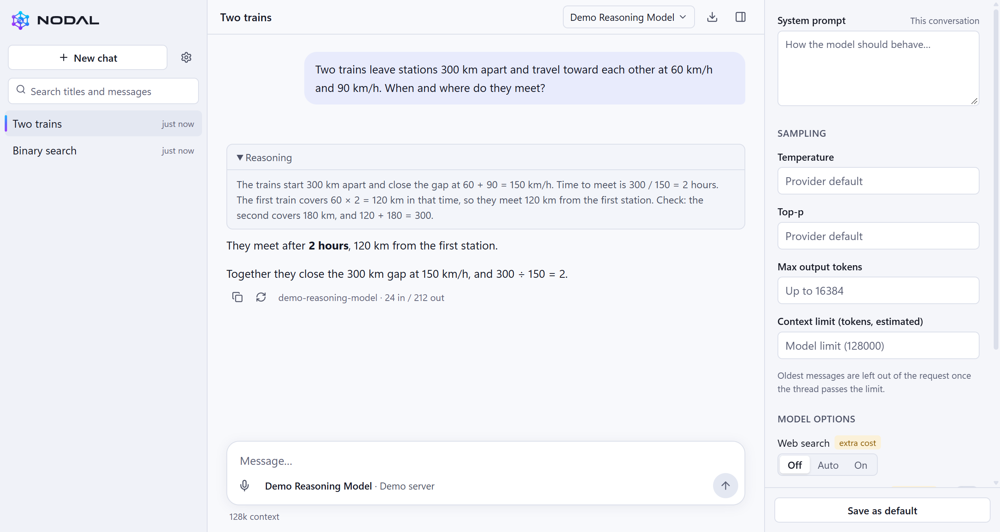

# User guide

Everything NODAL does, feature by feature. For first-time setup see the [quick start](quick-start.md); for a list of settings see the [configuration reference](configuration.md).

Shortcuts are written for Windows and Linux. On macOS, use `Cmd` in place of `Ctrl`.

## Contents

- [Providers and models](#providers-and-models)
- [Conversations](#conversations)
- [Editing, regenerating and branches](#editing-regenerating-and-branches)
- [The inspector: prompts and controls](#the-inspector-prompts-and-controls)
- [Reasoning](#reasoning)
- [Images](#images)
- [Voice chat](#voice-chat)
- [Search](#search)
- [Export and import](#export-and-import)
- [Encryption and locking](#encryption-and-locking)
- [Usage, balance and rate limits](#usage-balance-and-rate-limits)
- [When something goes wrong](#when-something-goes-wrong)

## Providers and models

A **provider** is a service or program that runs models: a cloud company you have an account with, or a local server on your own computer. NODAL can hold several at once.

- **Add or change providers** under *Settings → Providers*. Presets exist for Venice.ai, OpenRouter, OpenAI, LM Studio and Ollama; **Custom** takes any OpenAI-compatible base URL.
- **API keys** are checked when you enter them and stored encrypted by your operating system. NODAL never displays a saved key again, only its last four characters. Changing a provider's address deletes its stored key, so a key is never sent to a server it was not entered for.
- **The model picker** (`Ctrl+K`, or the model name in the header or message box) lists the models of every connected provider, with search. You can switch model at any point in a conversation; later replies use the new model.
- **Models not in the list** can be added by ID in the provider's settings, for endpoints that do not publish a model list.
- **The model list is refreshed** once a day, or when you ask for it in the provider's settings.

## Conversations

- `Ctrl+N` starts a new chat. Its title is taken from your first message; double-click a title in the sidebar to rename it.
- Hover over a conversation in the sidebar to **pin**, **rename**, **archive** or **delete** it. Archived chats are hidden unless you turn on *Show archived conversations* in *Settings → Appearance*.
- **Deleting** asks for a second click. A deleted conversation is removed from the database, and its attached images are deleted too.
- Replies appear as they are generated. The round button in the message box, or `Esc`, **stops** a reply and keeps what had arrived.
- If the application is closed or the connection drops mid-reply, the partial reply is kept and marked interrupted, with **Continue** and **Regenerate** offered.
- Replies are formatted: headings, lists, tables, and code blocks with syntax colouring and a copy button. Mathematical notation can be typeset if you turn on *Render math* in *Settings → Appearance*.
- **Links** in a reply open in your web browser only after a dialog shows you the full address. Images at remote addresses are never loaded automatically; they appear as links.

## Editing, regenerating and branches

Hover over a message to see its actions.

- **Edit and resend** (on your messages) lets you change what you asked and get a fresh reply.
- **Regenerate** (on a reply) asks the model again.
- **Continue** (on an interrupted reply) asks the model to carry on from where it stopped.

Neither editing nor regenerating destroys anything. Each creates a new **branch**: the earlier version is still there, and small arrows beside the message (*Previous version* / *Next version*) switch between them. The whole conversation below that point follows the version you select.

## The inspector: prompts and controls

The panel on the right (`Ctrl+I`) applies to the open conversation.

- **System prompt.** Standing instructions sent with every request: a role, a tone, rules to follow.
- **Temperature** and **Top-p.** How varied the model's word choices are. Left empty, the provider's or model's default applies, and NODAL shows that default when the provider reports it.
- **Max output tokens.** A cap on the length of each reply.
- **Context limit.** Models can only take in so much text at once. When a conversation grows past this limit, NODAL leaves the oldest messages out of the request (they stay in your conversation). The estimate is approximate.
- **Model options.** Controls that belong to the provider. With Venice.ai these include web search, citations, URL scraping, whether to include Venice's own system prompt, thinking controls, and, under *Advanced*, a **Character** chosen from a searchable list. Options that add charges are labelled *extra cost*; options the provider has not confirmed the model supports are labelled *unverified*.

**Save as default** at the bottom makes the current prompt, sampling values and model options the starting point for new chats.

## Reasoning

Some models produce their working-out before the answer. When a model sends it, NODAL puts it in a collapsible **Reasoning** block above the reply, so it never mixes with the answer itself.

<picture>
  <source media="(prefers-color-scheme: dark)" srcset="../assets/screenshots/reasoning-dark.png">
  
</picture>

Reasoning models can take a long time to begin answering. If a reply gives up too early, raise *Wait for first token* under *Settings → Network*.

## Images

With a model that accepts images, attach them with the image button in the message box, by pasting, or by dropping files onto it. PNG, JPEG, WebP and GIF are accepted, up to 20 MB each.

The button is hidden for models the provider says cannot see images. Where the provider does not say, the button is shown and marked *unverified*: the model may or may not accept the image.

Images are stored in NODAL's data folder and sent to the provider as part of the message.

## Voice chat

> **Experimental.** Voice chat is available with Venice.ai. It was built from Venice's API reference, where the speech services are marked Beta, and has been tested with a simulated microphone, not yet against the live service.

With a Venice.ai conversation open, the **microphone button** in the message box turns voice chat on.

1. Speak. When you pause for about a second, your words are transcribed and sent as an ordinary message.
2. The reply is read aloud, sentence by sentence, as it arrives.
3. NODAL listens again.

<picture>
  <source media="(prefers-color-scheme: dark)" srcset="../assets/screenshots/voice-dark.png">
  
</picture>

While it is on, a status line shows what it is doing:

- **Send now** ends your turn without waiting for a pause.
- **Skip** stops the reading and listens again.
- **Turn off voice** releases the microphone.

Things to know:

- It is **turn-based**, not a live call. Expect a short wait between finishing a sentence and hearing the answer, and you cannot interrupt mid-sentence except with Skip.
- It works with any Venice text model, because the model only ever receives text.
- Your speech is sent to Venice for transcription, and the reply text is sent to Venice to be spoken. Both are billed by Venice on your account.
- **Nothing extra is stored.** Spoken turns are saved as text, exactly like typed ones. Audio is not kept.
- The microphone is recorded only while NODAL is listening, never while a reply is being read.
- The first time, your operating system may ask whether NODAL may use the microphone.
- **Voice instructions** (*Settings → Appearance*) are added to the system prompt on spoken turns only. Use them to give the model a personality or way of speaking. They change the words the model chooses, not the voice that reads them; the voice is fixed in this release.

## Search

The search box above the conversation list searches titles and the full text of every message, in every conversation.

## Export and import

- **One conversation:** the download button in the header saves it as Markdown. *Settings → Data → Export this conversation* offers Markdown (the thread you see) or JSON (every branch).
- **Everything:** *Settings → Data → Export ZIP* writes all conversations, attached images, settings and provider configuration to one file. **API keys are never exported.**
- **Encrypted export** writes the same content to a `.nodalx` file protected by a passphrase you choose for that file.
- **Import** (*Settings → Data*, or *Restore from an export* on the welcome screen) merges an export into this installation. Items already present are skipped, so importing twice does no harm. An encrypted export asks for its passphrase.

A plain ZIP export is **not encrypted**, even when encryption is turned on in NODAL. Use *Encrypted export* for a protected copy.

## Encryption and locking

Off by default. *Settings → Security* turns it on.

**What it does.** Encrypts your conversations, the search index, attached images, settings and provider configuration on disk with a passphrase you choose. NODAL then opens on a lock screen and nothing is readable until the passphrase is entered. (API keys are a separate matter: they are always encrypted by the operating system, with or without this.)

> **There is no recovery.** If you forget the passphrase, your conversations cannot be opened by anyone, including the authors of NODAL. Keep an encrypted export somewhere safe.

**Locking.** With encryption on:

- **Lock now:** the lock button in the sidebar, the button in *Settings → Security*, or `Ctrl+Shift+L`. This stops any reply still arriving.
- **Lock automatically:** after a period without keyboard or mouse input in NODAL (15 minutes by default; 1 minute to 1 hour, or never). Unless set to *Never*, NODAL also locks when the computer is locked or goes to sleep. The automatic lock never cuts a reply off; it waits for it to finish.

**Wrong passphrases.** An optional setting, *Delete all chats after 5 wrong passphrases in a row*, permanently deletes all conversations, images and stored API keys on the fifth consecutive wrong passphrase. The lock screen shows how many tries remain. It protects against someone guessing at your keyboard; it does not protect against someone who copies the data folder and guesses elsewhere. Only a strong passphrase does that.

**Changing or turning it off** is done in the same place and requires the current passphrase.

The [architecture document](architecture.md#encryption-at-rest) describes how the encryption works and what it does not protect against.

## Usage, balance and rate limits

Under the message box, NODAL shows the token counts of the last reply and the model's context size. When the provider reports them, it also shows your remaining balance and how many requests or tokens remain before a rate limit.

## When something goes wrong

Errors from a provider are shown in the conversation in plain words (for example *Key rejected*, *Out of balance*, *Rate limited*, *Model or endpoint not found*), with the provider's own message, the HTTP status and a request ID you can quote to the provider's support. Temporary failures are retried automatically before an error is shown.

See [Troubleshooting](troubleshooting.md) for specific problems.
